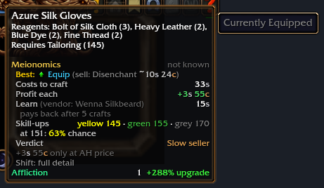
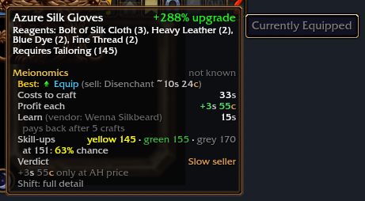
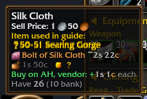
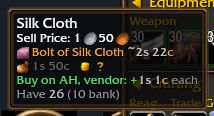

# TooltipFold

Tidies item tooltips in **WoW Forever**: lines that other addons add at the bottom are folded
into Blizzard's own lines, so tooltips stay short and read as one.

| Pawn: before | Pawn: after |
|---|---|
|  |  |
| **RestedXP: before** | **RestedXP: after** (guide for level 50, you're 30) |
|  |  |

## What it does

- **Pawn**: the upgrade percentage moves up beside the weapon's DPS, the armour value or the
  last stat line, and Pawn's own scale line is hidden. Hold **Shift** to see the scale and
  score again.
- **RestedXP Guides**: the "Item used in guide" lines become one line, with each guide named
  once, and only guides that start within 5 levels of yours. Hold **Shift** for all of them.
- **Meionomics**: its sale verdict moves up right under Sell Price when other addons' lines
  land in between.

Each fold only acts when that addon's lines are on the tooltip; without the addon it does
nothing.

## Commands

| Command | |
|---|---|
| `/tooltipfold` | Settings and the list of commands |
| `/tooltipfold pawn on`, `/tooltipfold pawn off` | Fold Pawn's lines or leave them |
| `/tooltipfold rxp on`, `/tooltipfold rxp off` | The same for RestedXP's guide lines |
| `/tooltipfold meio on`, `/tooltipfold meio off` | The same for Meionomics' verdict |
| `/tooltipfold near <levels>` | How far above your level a guide may start (default 5) |
| `/tooltipfold reset` | Back to the defaults |

## Install

Download this repository (green **Code** button, **Download ZIP**), and copy the
`addons\TooltipFold` folder into `World of Warcraft\_forever_\Interface\AddOns`, so that you
end up with `AddOns\TooltipFold\TooltipFold.toc`. Restart WoW fully (a `/reload` doesn't
find new addons).

Works with any of these, all optional:
PawnForever (WoW Forever's build of [Pawn](https://www.curseforge.com/wow/addons/pawn)),
[RestedXP Guides](https://www.restedxp.com) and
[Meionomics](https://github.com/MeioNeiz/Meionomics).

## Limits

- It recognises those addons by the text and colours they write. An update that changes
  them makes the fold step aside (the original lines stay) until TooltipFold is updated.
- Made and tested on an English client.

## Licence

[MIT](LICENSE)
